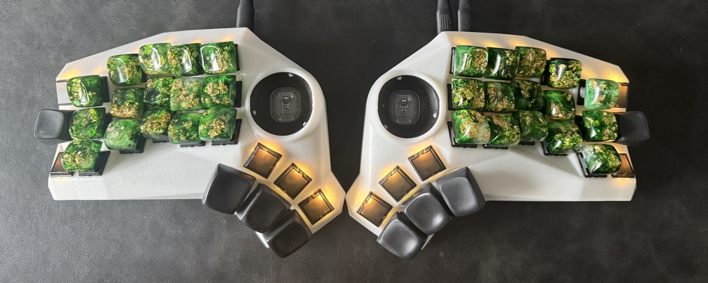
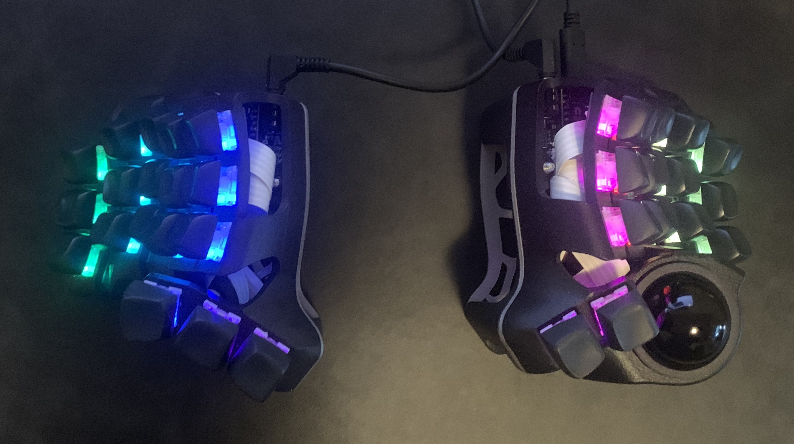

* My QMK Userspace

** Layout

alpha layer based on
https://sunaku.github.io/enthium-keyboard-layout.html

symbol based on https://github.com/getreuer/qmk-keymap

** Trainer

#+begin_example
just trainer charybdis   # or imprint / dilemma / spankbd
just serve               # serve the pages as they are, index of all four boards
just serve dilemma       # one board; builds it first if the page is missing
#+end_example

Reuses the keymap-drawer YAML and the QMK geometry to write a self-contained
HTML page (keymap-drawer/<target>_trainer.html), served at
http://127.0.0.1:8765/... because LibreWolf refuses to read file:// URLs from
the repo. Type the highlighted key on the
real keyboard, get wpm/accuracy and a list of keys that need work. Practice
flows through text, Drill quizzes single keys weighted by your mistakes,
Explore lights up whatever you press.

The target key is lit, the layer key you must hold is outlined dashed, and a red
dot marks keys you keep missing. When a character has several ways (b as the
combo or on Sym) Explore lists them and remembers the one you prefer; routes are
ranked base press, then combo, then a layered reach, preferring a layer key on
the other hand. Shifted characters (? + " _) are their own prompts.

The dropdown by /new text/ picks the practice text: easy, common or long words,
then words + punctuation, words + numbers, code. The difficulty that matters here
is which characters you have to reach for, since numbers send you to Num and code
symbols to Sym.

*** As a package

#+begin_example
nix build .#trainer
./result/bin/keymap-trainer              # index page of the four boards
./result/bin/keymap-trainer charybdis
#+end_example

It builds from committed files only (keymap-drawer/<target>.json, _output.yaml and
_layout.json) because a flake source carries no git submodules. After a board
change, refresh the geometry copies with just layouts; the test script fails if
they go stale.

*** Limits

- The page only sees what the browser sees, i.e. characters and modifiers. Keys
  that send nothing (MO/LT while held, macros, mouse and DPI keys) cannot be
  verified, so they are drawn but left out of the drills.
- Combos are judged by the character they produce, never by the two keys pressed.
  Press the members too slowly for COMBO_TERM and QMK sends the members instead,
  which the page counts as a mistake.
- Layer state is inferred from what you type, so it is known only once a key on
  that layer has been typed. Reporting it properly needs firmware help (Vial's
  WebHID protocol, which neither board here runs).

*** Follow-ups

- Finger hints and homing bars, derived from the geometry the way
  https://github.com/GordonMohrin/split-keyboard-for-monkeytype does it.

** [[https://github.com/Cyboard-DigitalTailor/vial-qmk/tree/cyboard/keyboards/cyboard/imprint/imprint_number_row][Cyboard imprint (3 rows no bottom row)]]

** BastardKB Charybdis 3x5

s
